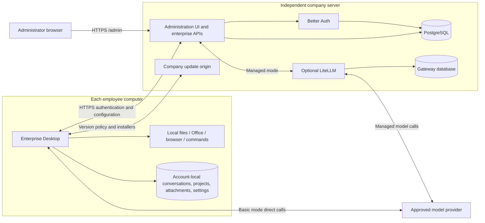

# Enterprise agent Desktop architecture and delivery plan

English | [中文](enterprise_agent_harness_proposal.zh.md)

## Summary

Employees sign in to DeepSeek Harness Desktop with company accounts, process local files, generate Office documents, and operate browsers using company-approved model APIs. The system uses a client/server deployment: the company server runs Better Auth, PostgreSQL, configuration APIs, and an independent administration website; each employee installs enterprise Desktop and connects over HTTPS for authentication, permissions, and model configuration. Accounts, permissions, and model assignments are centralized; conversations, projects, attachments, and personal settings stay on employee computers, without centralized conversation storage.

Basic mode distributes provider configuration and sends model calls directly from employee computers to providers. Optional managed mode routes calls through the enterprise backend and LiteLLM for budgets and usage. Local execution does not keep model inputs local: file content, screenshots, and tool results included in requests still reach the provider, and managed mode also sends them through the backend and LiteLLM.

## Table of Contents

- [1. Initial scope](#initial-scope)
- [2. Components and responsibilities](#components-and-responsibilities)
- [3. Deployment architecture](#overall-architecture)
- [4. Enterprise sign-in and Desktop integration](#enterprise-sign-in-and-desktop-integration)
- [5. Model provisioning and cost management](#model-provisioning-and-cost-management)
- [6. Local execution and data handling](#local-execution-and-data-handling)
- [7. Implementation, deployment, and acceptance](#implementation-deployment-and-acceptance)
- [8. Future extensions](#future-extensions)
- [Dev Note](#dev-note)

-----

## 1. Initial scope

Deliver the basic path first: deploy the server, create employees and model assignments in the administrator website, sign in from employee Desktop, and use local tools. Run a controlled pilot with one department, several dozen employees, and one desktop operating system. Managed accounting is optional and is not a basic-mode runtime dependency.

| Module | Initial requirements |
|---|---|
| Enterprise Desktop | Use official `apps/desktop` with independent branding, `appId`, signing, notarization, and updates; reuse local runtime and tools |
| Remote authentication | Run Better Auth only on the server; administrators create accounts; Desktop requires no local authentication service or database |
| Independent administration | Administrators access server `/admin` from an ordinary browser without installing or starting Desktop; manage employees, roles, and model assignments |
| Local data | Give each company/employee account its own `DSH_HOME`; preserve projects and history across switching and reject cross-account reads |
| Model configuration | Supply a small approved model catalog, explicit capabilities, and a default model; employees do not enter provider credentials |
| Optional managed accounting | LiteLLM enforces employee model access and monthly budgets and meters usage; the backend configures and displays results |
| Company SOPs | Existing skills and Office templates ship with the installer and remain extensible through skills and plugins |

The initial scope excludes public registration, independent SSO, multiple tenants, wallets, payments, plans, complex departmental accounting, centralized conversation synchronization, and a generic MCP gateway.

-----

## 2. Components and responsibilities

| Component | Choice and responsibilities |
|---|---|
| Desktop | Official Electron application and `dsh` profile; do not add another Desktop distribution or agent loop |
| Authentication | Server-side Better Auth with Admin and Bearer plugins for password hashing, login limits, sessions, users, and roles |
| Administration UI and business APIs | A lightweight application-owned UI and enterprise APIs; reuse Better Auth administrative APIs and own model assignments and optional budgets |
| Persistence | PostgreSQL stores authentication data and encrypted model configuration; LiteLLM uses a separate database when enabled |
| Model gateway | Optional pinned and qualified open-source LiteLLM with management APIs; provider credentials and employee virtual keys stay on the server |

### Better Auth and the administration UI

Better Auth implements authentication rather than the complete application administration website. Its [Admin plugin](https://better-auth.com/docs/plugins/admin) provides user, role, ban, password, and session APIs. DSH pages call enterprise APIs, whose server-side authorization layer invokes those APIs. Model provisioning, provider configuration, gateway associations, and budgets belong to DSH. Do not introduce a complete third-party authentication dashboard for the initial release; reuse UI components as useful, without implementing password hashing or session protocols.

### Release and gateway versions

The enterprise distribution owns its name, artwork, application identity, signing credentials, and update destinations, following the [official publishing workflow](../../apps/desktop/publishing/README.md) and [Windows signing requirements](../../apps/desktop/windows-signing/README.md). Official updates must not replace the enterprise client. The [enterprise application reference](../../backend/README.md#enable-managed-mode) owns the LiteLLM version, configuration, and qualified APIs; commercial SSO, SCIM, and administrative auditing are not dependencies.

-----

## 3. Deployment architecture

Maintain server deployment settings separately from Desktop release settings. The server holds database access, `BETTER_AUTH_SECRET`, bootstrap administrator credentials, and gateway management credentials. Desktop seals only its public HTTPS origin, company identity, and update metadata; it does not distribute server configuration, a database, or the authentication service. Administration and authentication APIs may share an origin and backend process; independent browser access does not require a second authentication system.

The public server origin must be reachable from employee computers. Their `127.0.0.1` addresses refer to those computers, used for temporary sign-in callbacks and local Hosts. A loopback HTTP authentication origin is only for developing the server and Desktop on the same machine; packaged Desktop requires HTTPS.

-----

## 4. Enterprise sign-in and Desktop integration

Employees use company accounts without official DeepSeek accounts, payments, or manually entered model keys. Welcome opens the server sign-in page in the system browser; server-side Better Auth verifies passwords. Welcome requires sign-in, and the workspace Host starts only after authentication and account configuration preparation succeed. After sign-in, employees can configure personal providers in Settings alongside the enterprise route.

### Sign-in and configuration synchronization

1. Administrators create employees and assign models at `/admin`. Public registration is disabled, and server-side checks authorize every administrative API.
2. Electron starts expiring browser authorization with random state, S256 PKCE, and a temporary loopback callback. The browser returns a one-use code, which the main process exchanges with the server for an independent Desktop session; URLs carry neither login tokens nor model credentials.
3. The main process fetches and validates company ID, stable employee ID, hard expiry, and complete model configuration. It initializes account-owned `DSH_HOME` and `profiles/desktop`, writes and verifies credentials and complete model settings, then starts the Host through its `dsh` profile. Failures stay in sign-in or recovery without using another account or default configuration.
4. The main process encrypts saved login tokens with operating-system secure storage. Model credentials live in the account credential file, outside ordinary settings, prompts, logs, and renderers. Basic-mode provider keys remain readable by the same operating-system user.
5. Synchronize employee status and configuration at startup, resume, and every 15 minutes by default. A `401`, `403`, or local hard expiry stops the Host and tasks, clears sessions and model credentials, and returns to sign-in. Network errors, timeouts, and server `5xx` responses allow cached configuration only until hard expiry, with persistent synchronization-unavailable feedback.
6. Live rotation writes a new endpoint-and-credential-derived reference before replacing complete provider settings and the default model. Retain old references until Host exit so prepared requests can finish. Partial or uncertain writes stop the Host without reporting success. The backend supplies explicit configuration fields rather than executable Cordis expressions or plugin code.

### Accounts and local data isolation

Only server-authenticated company and stable employee IDs select account directories, named by `SHA-256(UTF-8(JSON.stringify([enterpriseId, userId])))`. Name, email, token, and model-key changes do not change ownership. Equal employee IDs in different companies remain isolated, and recreated accounts do not reuse deleted identities.

Each account owns its profile, conversations, attachments, project index, credentials, personal settings, and extracted runtime dependencies. Switching first completes existing task confirmation, stops the old Host, terminals, and background work, awaits exit, closes storage, and clears renderer caches and embedded browser partitions. Only then initialize and start the new account Host. Old results must not reach the new account. Machine-level windows, shortcuts, crash logs, and encrypted login metadata remain in Electron `userData`.

Sign-out, switching, restart, and upgrades must preserve history. Returning accounts reuse their directories, retaining projects, complete conversations, attachments, personal settings, and conversation continuation. Enterprise Desktop does not import default `~/.dsh` automatically; migration requires an explicit target account. Third-party-plugin recovery backs up and resets the current account's profile; the next startup prepares its enterprise account configuration before starting the Host.

Directory separation covers application-managed data without relocating project source files or adding operating-system permissions or encryption. People sharing an operating-system user can still read other account directories through the filesystem. Use separate operating-system accounts when employees need filesystem access isolation.

### Sign-out and deactivation

Sign-out clears local enterprise sessions and model credentials. Deactivation rejects subsequent authentication, provisioning, and managed model calls. Basic mode requires separately revoking distributed provider keys; a shared key cannot revoke one employee independently. Managed mode also revokes the employee virtual key, retaining visible cleanup-required state and retry on failure. Distinguish account deactivation from provider-key revocation; already-issued upstream calls are not guaranteed to stop immediately.

-----

## 5. Model provisioning and cost management

| Mode | Request path and management requirements |
|---|---|
| Basic, default | Desktop → provider; the backend stores and distributes settings without proxying calls, metering, budgets, or model rate limits; UI shows no enterprise usage |
| Managed, optional | Desktop → backend → LiteLLM → provider; the backend verifies sessions and approved models, while the gateway enforces permissions, budgets, rate limits, and accounting |

Administration provides employee creation, role changes, password resets, deactivation, and model assignments. Managed mode adds gateway model discovery, monthly employee budgets, and paginated usage filtered by employee, model, and UTC dates. Password resets revoke sessions; administrators cannot demote or deactivate themselves. Ordinary employees may open the sign-in document but cannot use administrative APIs or read administrative data.

Basic-mode model lists are client configuration; provider credentials determine actual access, so use distributable and independently revocable keys. Managed mode checks model access on the server, rejects request overrides of upstream endpoints or credentials, and keeps provider, LiteLLM management, and employee virtual keys off Desktop. Model-call credentials are bound to live enterprise sessions.

Enable managed mode through server environment settings and verify gateway connectivity; missing configuration or outages must not fall back to direct calls. Budgets bind company and stable employee IDs; multiple devices, logins, and virtual-key changes do not reset monthly spend. Configure finer departmental, model, TPM, RPM, and concurrency policies through supported gateway capabilities without rebuilding the complete gateway console.

Before migrating from basic mode, administrators must revoke distributed provider keys and record confirmation, then assign backend endpoints and enterprise credentials to prevent direct-call bypass. Usage begins when managed mode is enabled, distinguishing monthly budget spend from filtered request history. State currency and gateway pricing explicitly and reconcile with provider bills, without payments or wallets.

Failures distinguish budget/rate limits, forbidden models, expired sessions or credentials, and unavailable services, with actions such as selecting an approved model, signing in again, or contacting an administrator. Failed usage reads show unknown or unavailable, never zero cost; failed writes do not report applied configuration.

-----

## 6. Local execution and data handling

Local files, Office, browser, and command tools retain official runtime, sandbox, and approval behavior; do not add separate Ask / Plan / Craft execution modes. [Plan mode](../../packages/plan/plan-mode/README.md) does not disable tools and cannot guarantee that execution waits for approval. Verify workspace writes, out-of-scope access, approvals, and tool availability on the target operating system.

- Product analytics, feedback telemetry, and anonymous identity reporting retain standard configuration and collection destinations.
- The plugin market, management service and UI, plugin-management tools in every preset, and runtime self-modification remain available. The shell supplies its bundled package manager, Desktop CLI installation, and third-party-plugin recovery.
- Search, fetching, and browser operations retain their existing configuration and credential requirements. Update checks, policies, and installers use explicitly configured HTTPS destinations without an enterprise-domain restriction.
- Enterprise sign-in adds no data-category or SOP/template approval requirement. External cloud drives and business systems remain accessible through supported plugins and MCP connections configured by the user.

-----

## 7. Implementation, deployment, and acceptance

### Delivery sequence

| Stage | Deliverables and exit criteria |
|---|---|
| Server and independent administration | Deploy authentication, database, and administration on an independent server; an ordinary browser completes administrator login, employee management, and model assignment without Desktop processes; employee administration is rejected |
| Desktop authentication and isolation | Desktop uses the remote origin; browser login, recovery, expiry, sign-out, and deactivation work; Host starts after complete preparation, and switching/restart preserve and separate history |
| Basic models and controlled tools | Direct provider calls support streaming, tools, and Office/browser tasks without backend model traffic; verify approvals, network policy, and credential revocation |
| Optional managed mode | Qualify pinned LiteLLM, stable employee associations, streaming, budgets, usage, deactivation, and cleanup retry; confirm old provider keys were revoked before migration |
| Enterprise release and pilot | Sign and notarize the target-platform build and upgrade through company updates, preserving accounts, settings, history, and gateway spend; one department completes real tasks and backup restoration |

With parallel frontend/backend work, ready signing credentials, one operating system, and no complex legacy integration, target a 4–6 week pilot. Confirm scheduling after basic qualification; estimate dual-platform delivery and further integrations separately rather than promising a complete enterprise platform timeline.

### Deployment and resources

Start with local Docker deployment and verify administration and Desktop development against the loopback IP address. A domain is not a prerequisite. When moving to a server, use a reachable server IP or domain with an HTTPS certificate trusted by employee computers; loopback HTTP remains limited to development on the same machine.

Maintain the enterprise service in the top-level `backend/` directory and deploy it only through Docker Compose. The backend container initializes its service profile and launches `dsh --profile enterprise` internally. Compose also provides PostgreSQL and the static update origin behind an existing company HTTPS proxy or optional Caddy. Managed mode adds LiteLLM and its own database. The [enterprise application reference](../../backend/README.md) owns deployment commands, environment settings, Desktop release templates, and backup procedures; do not distribute server `.env` files to employees.

Run one backend container. Back up databases, unchanged encryption secrets, update artifacts, and managed-mode database/salt; verify identities, assignments, gateway associations, and accumulated spend after isolated restoration. No local large-model hosting or vectorization requires GPUs. Measure capacity from concurrency, request duration, database load, and retention rather than promising 200–1000 employees or adding replicas before the pilot.

### Required acceptance results

- The server runs independently without Desktop. An administrator uses another browser at `/admin` to sign in and configure the application; signed-out users and ordinary employees cannot read or change administrative data.
- Employee Desktop needs no Better Auth server, database, server secret, or server `.env`. Its remote HTTPS origin serves browser login, session verification, and provisioning; the loopback listener accepts only short-lived authorization codes.
- Basic streaming and tool calls go directly to providers; the backend has no model traffic, employee metering, budgets, or model rate limiting, and the UI shows no enterprise usage.
- Startup, resume, and periodic synchronization handle deactivation, `401`, `403`, temporary disconnection, timeouts, and `5xx`. Hard expiry stops tasks and clears credentials; transient failures retain valid caches with visible degradation. Rotation preserves prepared calls, while failed updates stop execution.
- After A creates projects, complete conversations, and attachments and signs out, B cannot read A through lists, search, known Session IDs, or attachment references, including after restart. After B creates data, returning to A and restarting preserves A history, settings, and conversation continuation. Also verify equal user IDs across companies, name/email changes, recreated accounts, and separation from default `~/.dsh`.
- Missing authentication, invalid identity, partial settings/credential writes, failed task shutdown, and failed Host restart prevent entering a new workspace. Old task output cannot reach a new account, and crash recovery targets only the current account's profile and restores enterprise configuration before Host startup.
- Independently verify provider-key revocation in basic mode. Managed qualification covers forbidden models, cross-device spend, unchanged budgets after login, exhausted budgets, stream interruption, retries, concurrency, cleanup failures, and recovery, without direct-call fallback, false success, or zero-cost displays on failure.
- Complete Word, Excel, PowerPoint, and browser tasks on the target platform and verify workspace/approval behavior. Verify telemetry configuration, plugin installation, self-modification, search, Desktop CLI installation, recovery, and configured update destinations. Pilot infrastructure must provide signing, notarization, update-upgrade, and backup-restoration evidence.

-----

## 8. Future extensions

| Need | Prerequisites |
|---|---|
| Shared login across applications | Integrate an existing identity system or assess independent SSO when multiple applications require it; retain DSH business authorization |
| Cloud drives and knowledge | Pilot one authorized directory, verify inherited access, revocation, synchronization, and failures, then assess retrieval engines |
| OA / ERP | Start with a few read-only MCP APIs and explicit employee authorization; separately design confirmations and duplicate-submission handling for writes |
| Independent SOP updates | Add versioned and recoverable distribution only when bundled delivery cannot meet requirements |

-----

## Dev Note

This document defines requirements and acceptance; the [enterprise application reference](../../backend/README.md) owns implementation and operation. Sources and automated checks prove only the behavior they cover. A reachable HTTPS IP address or domain, certificate trust, enterprise signing/notarization, update publication, approved models and Office tasks, capacity, and restoration drills require verification on target infrastructure; passing local tests does not replace deployment acceptance.
