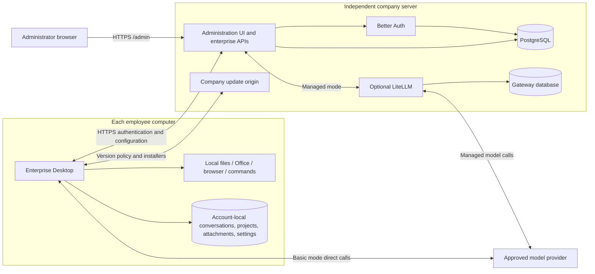

# 企业内部 agent 桌面应用架构与实施方案

[English](enterprise_agent_harness_proposal.md) | 中文

## 概述

员工使用企业账号登录 DeepSeek Harness 桌面应用，在本机处理文件、生成 Office 文档和操作浏览器，使用企业采购的模型 API。系统采用 C/S 架构：企业服务器运行 Better Auth、PostgreSQL、配置接口和独立网页管理后台；每位员工在个人电脑安装企业桌面端，通过 HTTPS 登录服务器并获取权限和模型配置。账号、权限和模型配置集中保存；会话、项目、附件和个人设置保存在员工电脑，不建设集中会话存储。

基础模式由后台下发供应商配置，模型请求从员工电脑直达供应商；精细化模式按需接入 LiteLLM，模型请求经过企业后台和网关，执行预算与用量管理。本地执行不表示数据不出本机：进入模型请求的文件内容、截图和工具结果仍会发送给模型供应商，精细化模式还会经过后台与 LiteLLM。

## 目录

- [一、首期范围](#initial-scope)
- [二、技术选型与职责](#components-and-responsibilities)
- [三、总体架构](#overall-architecture)
- [四、企业登录与桌面接入](#enterprise-sign-in-and-desktop-integration)
- [五、模型下发与费用管理](#model-provisioning-and-cost-management)
- [六、本地执行与数据处理](#local-execution-and-data-handling)
- [七、实施、部署与验收](#implementation-deployment-and-acceptance)
- [八、后续扩展](#future-extensions)
- [开发备注](#dev-note)

-----

## 一、首期范围

先完成“服务器部署 → 管理员网页创建员工并分配模型 → 员工桌面登录 → 本地工具调用”的基础路径，以一个部门、几十名员工和一种桌面操作系统开展受控试点。精细化管理按需启用，不作为基础模式的运行依赖。

| 模块 | 首期要求 |
|---|---|
| 企业桌面 | 基于官方 `apps/desktop`，提供独立品牌、`appId`、企业签名、公证和更新源；复用本地运行时与工具 |
| 远程认证 | Better Auth 仅在服务器运行，管理员创建账号；桌面无需本地认证服务或数据库 |
| 独立管理后台 | 管理员使用普通浏览器访问服务器 `/admin`，无需安装或启动桌面端；管理员工、角色与模型配置 |
| 本地数据 | 每个企业和员工账号使用独立 `DSH_HOME`；切换后保留原有项目与历史，禁止跨账号读取 |
| 模型配置 | 下发少量获批模型、明确能力和默认模型；员工无需填写模型凭证 |
| 可选精细化管理 | LiteLLM 执行员工模型权限、月预算及用量计量，后台提供配置和展示 |
| 企业 SOP | 现有技能与办公模板随安装包交付，并可通过技能与插件继续扩展 |

首期不包含公开注册、独立 SSO、多租户、充值钱包、套餐、复杂部门分摊、集中会话同步或通用 MCP 网关。

-----

## 二、技术选型与职责

| 组件 | 选择与职责 |
|---|---|
| 桌面端 | 官方 Electron 桌面应用及 `dsh` profile；不新增独立桌面发行版或智能体循环 |
| 认证 | Better Auth 服务端库及 Admin、Bearer 插件，处理密码哈希、登录限速、会话、用户和角色 |
| 管理界面与业务接口 | 自研轻量管理页面与企业接口；复用 Better Auth 管理 API，负责模型分配和可选额度管理 |
| 持久化 | PostgreSQL 保存认证数据与加密模型配置；启用网关时为 LiteLLM 使用独立数据库 |
| 模型网关 | 可选的 LiteLLM 开源版，固定验证版本并使用管理 API；供应商凭证和员工虚拟 Key 保留在服务端 |

### Better Auth 与管理界面

Better Auth 是认证实现，不是本应用完整的业务管理后台。其 [Admin 插件](https://better-auth.com/docs/plugins/admin)提供用户、角色、停用、密码和会话管理 API；DSH 管理页面调用企业接口，由服务器执行权限检查并调用这些 API。模型下发、供应商配置、网关关联和预算属于 DSH 业务。首期不引入完整第三方认证管理后台；可按需复用开源 UI 组件，不自行实现密码哈希或会话协议。

### 发布与网关版本

企业发行版使用企业自己的名称、图标、应用标识、签名证书和更新地址，复用[官方发布流程](../../apps/desktop/publishing/README.zh.md)与 [Windows 签名要求](../../apps/desktop/windows-signing/README.zh.md)。官方更新源不能覆盖企业客户端。LiteLLM 的版本、环境变量及已验证接口以[企业应用说明](../../backend/README.zh.md#enable-managed-mode)为准，不依赖其商业 SSO、SCIM 或管理审计功能。

-----

## 三、总体架构

服务器部署文件和桌面发布配置分开维护。服务器持有数据库地址、`BETTER_AUTH_SECRET`、引导管理员和网关管理凭证；桌面只固化公开 HTTPS 服务地址、企业标识与更新元数据，不分发服务器配置文件、数据库或认证服务。管理员后台可与认证接口共用域名和后端进程，独立访问不要求另起一套认证系统。

服务器公开地址必须能从员工电脑访问。员工电脑上的 `127.0.0.1` 指向员工自己，仅临时登录回调和本地 Host 使用回环地址；服务端与桌面同机开发时才使用回环 HTTP 认证地址，安装版要求 HTTPS。

-----

## 四、企业登录与桌面接入

员工只使用企业账号，无需 DeepSeek 官方账号、充值或自行填写模型 Key。欢迎页通过系统浏览器打开服务器登录页；密码由服务器上的 Better Auth 验证。欢迎页要求登录，只有完成身份认证和账号配置准备后才启动工作区 Host。登录后，员工可在设置中维护企业路由之外的个人供应商。

### 登录流程与配置同步

1. 管理员在 `/admin` 创建员工并分配模型；公开注册关闭，管理接口在服务端验证管理员角色。
2. Electron 主进程发起有时限的浏览器授权，使用随机状态、S256 PKCE 和临时回环回调。浏览器仅返回一次性授权码，主进程向服务器交换独立桌面会话；URL 不携带登录 token 或模型凭证。
3. 主进程获取并校验企业 ID、稳定员工 ID、硬过期时间和完整模型配置，按账号初始化 `DSH_HOME` 及 `profiles/desktop`，先写入凭证和整组模型配置并读回校验，再通过 `dsh` profile 启动 Host。失败时停留在登录或恢复界面，不使用旧账号或默认配置。
4. 登录 token 由主进程通过系统安全存储加密保存；模型凭证使用当前账号的本地凭证文件，不进入普通配置、提示词、日志或渲染层。基础模式的供应商 Key 仍可被同一操作系统用户读取。
5. 启动、休眠唤醒及默认每 15 分钟同步员工状态和配置；收到 `401`、`403` 或到达本地硬过期时间时停止 Host 和任务、清理会话与调用凭证并返回登录。网络、超时或服务器 `5xx` 失败时仅在硬有效期内使用缓存，并持续显示同步不可用状态。
6. 运行中轮换模型配置先写入新的地址与凭证摘要引用，再整体替换提供方配置和默认模型；旧引用保留到 Host 停止，使已准备的请求能够完成。部分成功或结果不确定时停止 Host，不报告成功。后台只下发明确配置字段，不下发可执行 Cordis 表达式或插件代码。

### 账号与本地数据隔离

账号目录只能由服务端认证的企业 ID 和稳定员工 ID 决定，采用 `SHA-256(UTF-8(JSON.stringify([enterpriseId, userId])))` 生成固定目录名。姓名、邮箱、token 或模型 Key 变更不改变数据归属；相同员工 ID 在不同企业中隔离，注销后重建的账号不复用旧 ID。

每账号独立保存 profile、会话、附件、项目索引、凭证、个人设置和按需解压的运行依赖。切换前完成既有任务确认，停止旧 Host、终端及后台任务并等待退出，关闭旧存储并清理界面缓存与内嵌浏览器分区，再用新账号路径初始化和启动 Host。旧结果不得写入新账号。机器级窗口、快捷键、崩溃日志和加密会话元数据保留在 Electron `userData` 中。

普通退出、账号切换、应用重启和升级不得删除或覆盖历史；同一账号再次登录复用原目录，保留项目、完整对话、附件和个人配置，并能继续原对话。企业版不自动读取默认 `~/.dsh`；存量迁移必须明确指定目标账号。“禁用第三方插件后重启”会备份并重置当前账号的 profile；下次启动会在启动 Host 前重新准备企业账号配置。

目录隔离覆盖应用管理的数据，不移动项目原始文件，也不提供额外操作系统权限或加密；共用同一系统用户的人仍可从文件系统读取其他账号目录。需要人员之间的文件访问隔离时，使用独立操作系统账号。

### 退出与停用

退出清除本机企业会话和模型凭证，停用阻止后续认证、配置下发及精细化模型请求。基础模式必须在供应商侧另行撤销已分发 Key，共享 Key 无法单独撤销一人。精细化模式还需禁用员工虚拟 Key，失败时保留可见的待清理状态与重试入口。页面区分账号停用和供应商凭证撤销，已经发出的上游请求不承诺立即终止。

-----

## 五、模型下发与费用管理

| 模式 | 请求路径与管理要求 |
|---|---|
| 基础，默认 | 桌面 → 供应商；后台只保存及下发配置，不代理模型请求、不计量或执行额度和限流，界面不显示企业用量 |
| 精细化，可选 | 桌面 → 后台 → LiteLLM → 供应商；后台认证会话和获批模型，网关执行模型权限、预算及限流并计量 |

管理员页面提供员工创建、角色调整、密码重置、停用和模型分配；精细化模式增加从网关读取模型清单、员工月预算以及按员工、模型和 UTC 日期范围分页查询的用量。密码重置撤销会话，拒绝管理员自行降权或停用自己；普通员工即使能打开登录页面，也不能调用管理接口或读取管理数据。

基础模式的模型列表只是客户端配置，实际权限取决于供应商凭证；使用可分发、可独立撤销的 Key。精细化模式由服务器核验模型权限，拒绝模型请求中的上游地址和凭证覆盖，供应商 Key、LiteLLM 管理 Key 和员工虚拟 Key 不下发桌面；调用凭证绑定有效企业会话。

精细化模式通过服务器环境变量启用并校验网关连通性，配置缺失或故障不能回退直连。员工预算绑定企业及稳定用户 ID，跨设备、重新登录和更换虚拟 Key 不重置月度累计支出；更细的部门、模型、TPM、RPM 和并发策略按网关能力配置，不重建完整网关控制台。

从基础模式迁移前，管理员必须撤销已分发供应商 Key 并记录确认时间，再下发后台调用地址及企业凭证，防止继续直连绕过限制。用量从精细化启用时开始，区分月预算累计和所选日期的调用历史；币种及网关价格明确，实际费用与供应商账单核对，不建设支付或钱包。

失败提示区分额度或限流、模型无权限、会话或凭证失效以及服务不可用，提供更换获批模型、重新登录或联系管理员等操作。用量读取失败显示未知或暂不可用，不显示零费用；配置写入失败不得报告已生效。

-----

## 六、本地执行与数据处理

本地文件、Office、浏览器和命令工具继续复用官方运行时、沙箱与审批机制；不增加 Ask / Plan / Craft 三套执行模式。[Plan 模式](../../packages/plan/plan-mode/README.zh.md)不禁用工具，不能作为批准前不执行的保证。目标操作系统必须验证工作目录写入、越界访问、审批及工具可用性。

- 产品分析、反馈日志与匿名身份上报沿用标准配置和收集地址。
- 插件市场、插件管理服务与界面、所有预设中的插件管理工具和运行时自修改保持可用；壳层提供随包包管理器、桌面 CLI 安装和第三方插件恢复入口。
- 搜索、网页抓取和浏览器操作沿用现有配置及凭证要求；更新检查、策略与安装包使用显式配置的 HTTPS 地址，不限制为企业域名。
- 企业登录不增加模型数据类别、SOP 或模板审核要求；外部云盘与业务系统可通过受支持的插件和 MCP 连接按需配置接入。

-----

## 七、实施、部署与验收

### 实施顺序

| 阶段 | 交付与退出条件 |
|---|---|
| 服务器与独立后台 | 在独立服务器部署认证、数据库和管理页面；浏览器完成管理员登录、员工管理和模型分配；无需任何桌面进程，普通员工被拒绝管理访问 |
| 桌面登录与隔离 | 桌面仅配置远程服务地址，浏览器登录、恢复、到期、退出及停用生效；完整配置后启动 Host，账号切换与重启保留且隔离历史 |
| 基础模型与受控工具 | 直连供应商完成流式对话、工具调用及 Office/浏览器任务，后台没有模型流量；验证审批、网络出口和凭证撤销 |
| 可选精细化管理 | 验证固定 LiteLLM 版本、稳定员工关联、流式转发、预算、用量、停用与清理重试；迁移确认旧凭证已撤销 |
| 企业发布与试点 | 完成目标平台签名、公证及企业更新源升级，升级后账号、配置、历史和网关累计支出保留；一个部门执行真实办公任务并完成备份恢复 |

前后端可并行、证书已就绪、单一操作系统且无复杂存量集成时，以 4～6 周作为试点目标；研发在基础验证后确认排期，双平台和后续集成另行评估，不承诺完整企业平台工期。

### 部署与资源

先使用本机 Docker 部署，通过回环 IP 地址验证管理后台和桌面开发接入。域名不是前置条件。迁往服务器时，使用可访问的服务器 IP 或域名，并配置员工电脑信任的 HTTPS 证书；回环 HTTP 仅用于同机开发。

企业服务集中维护在顶层 `backend/` 目录，统一通过 Docker Compose 部署。后台容器初始化服务 profile，并在容器内通过 `dsh --profile enterprise` 启动。Compose 同时提供 PostgreSQL 和静态更新源；使用企业已有 HTTPS 入口，或可选 Caddy 入口。精细化模式再叠加 LiteLLM 及独立网关数据库。部署命令、环境变量、桌面发布模板和备份方法以[企业应用部署说明](../../backend/README.zh.md)为准；服务器 `.env` 不分发给员工。

运行一个后台容器。数据库、保持不变的加密密钥、更新产物及精细化数据库和 salt 均需备份；隔离恢复后验证身份、模型配置、网关关联和累计支出。首期不部署大模型或向量化任务，无需 GPU。容量按并发、持续时间、数据库和留存量实测，不按员工总数承诺 200～1000 人，也不在试点前增加副本。

### 必须验证的结果

- 服务器在没有桌面应用的环境独立运行；管理员从另一浏览器访问 `/admin` 完成登录及配置，未登录和普通员工不能读取或修改管理数据。
- 员工桌面不需要 Better Auth 服务、数据库、服务器密钥或服务器 `.env`；配置的远程 HTTPS 地址同时用于网页登录、会话校验及模型配置获取，回环监听仅接收短期授权码。
- 基础模式流式响应与工具调用直达供应商，后台没有模型流量、用户计量、额度或模型限流，界面没有企业用量展示。
- 启动、唤醒和周期同步处理停用、`401`、`403`、临时断网、超时及 `5xx`；硬过期停止任务并清理凭证，临时失败在有效期内保留缓存并可见；配置与凭证轮换不中断已准备请求，失败不继续运行。
- A 创建项目、完整对话与附件并退出后，B 登录及重启不能从列表、搜索、已知会话 ID 或附件引用读取 A 的数据；B 创建数据后切回 A 并重启，A 的原有历史、设置和继续对话能力保留。不同企业的相同用户 ID、姓名邮箱修改、注销重建与默认 `~/.dsh` 同时验证。
- 未登录、身份错误、配置或凭证部分写入、旧任务停止失败及 Host 重启失败都阻止进入新工作区；旧任务输出不得进入新账号，崩溃恢复只操作当前账号的 profile，并在启动 Host 前恢复企业配置。
- 基础模式单独验证供应商 Key 撤销；精细化模式验证模型拒绝、跨设备累计、重登不重置预算、超额、流式中断、重试、并发、清理失败及恢复，任何故障不回退直连或展示虚假成功与零费用。
- 在目标平台完成 Word、Excel、PPT 和浏览器任务，验证工作目录和审批；检查遥测配置、插件安装、自修改、搜索、桌面 CLI 安装、恢复及配置的更新地址；签名、公证、更新升级及备份恢复必须由试点基础设施给出证据。

-----

## 八、后续扩展

| 需求 | 扩展前提 |
|---|---|
| 多应用统一登录 | 确有多应用需求时接入现有身份系统或评估独立 SSO，后台继续维护 DSH 业务权限 |
| 云盘和知识库 | 先从单一授权目录试点，验证权限继承、撤权、同步与失败处理，再评估检索引擎 |
| OA / ERP | 从少量只读 MCP 接口开始，明确员工授权；写入另行设计确认及重复提交处理 |
| SOP 独立更新 | 随包交付不能满足需求后，再增加有版本记录和回退能力的分发 |

-----

## 开发备注

本文是需求与验收参考，软件实现及运行方式由[企业应用说明](../../backend/README.zh.md)维护。源码和自动化检查只能证明其覆盖的行为；可访问的 HTTPS IP 地址或域名、证书信任、企业签名、公证、更新发布、获批模型与办公任务、容量及恢复演练仍需在目标基础设施逐项验证，不能以本地测试通过替代上线验收。
